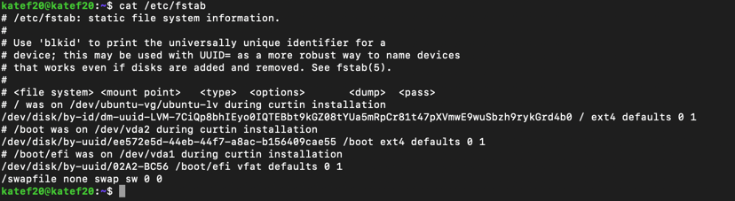
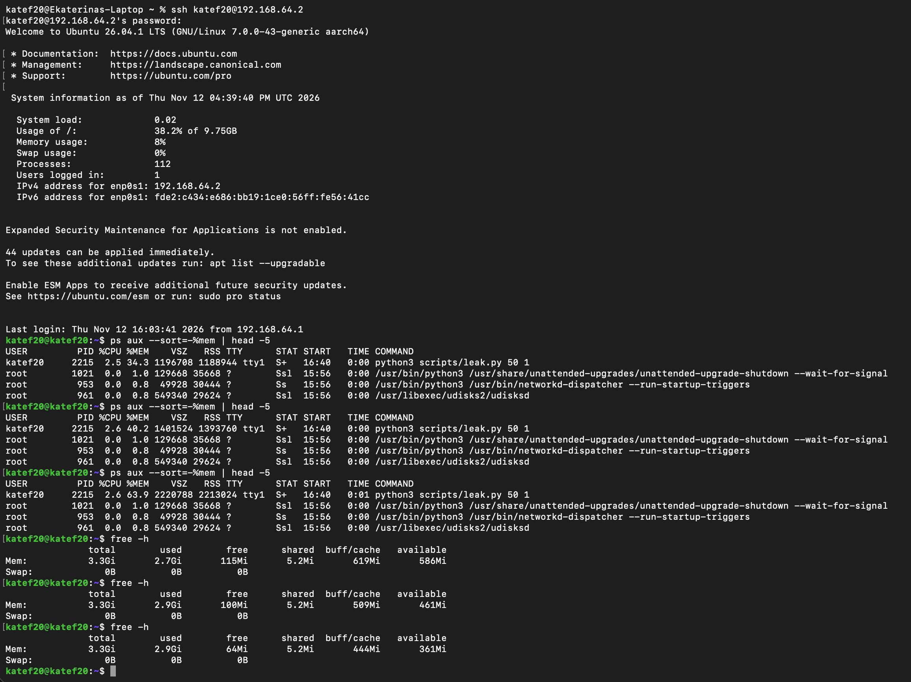
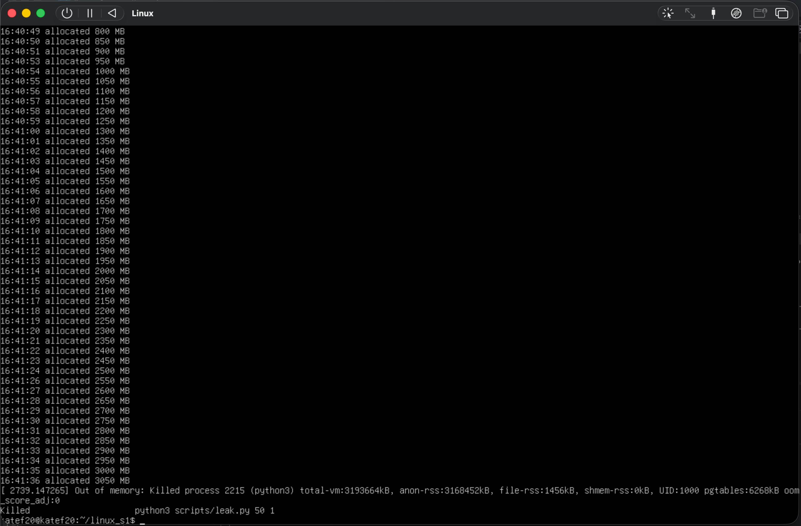
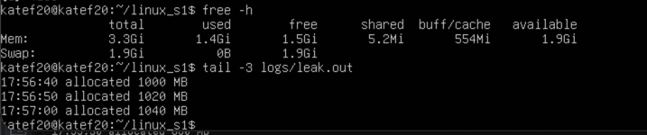
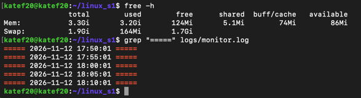
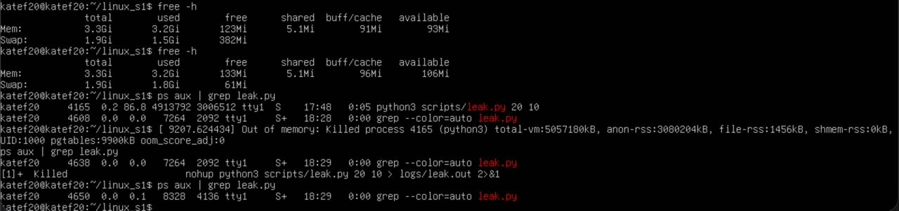
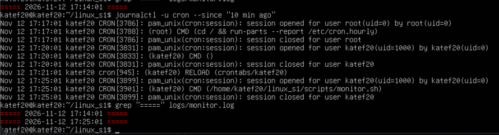
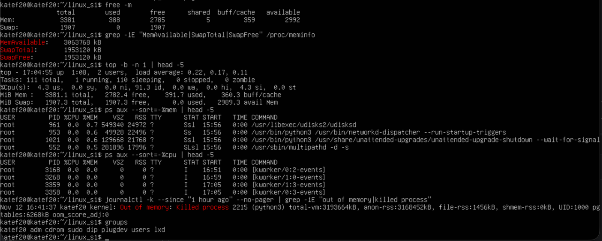
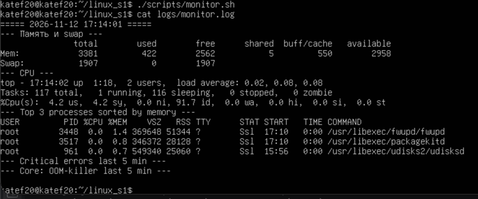
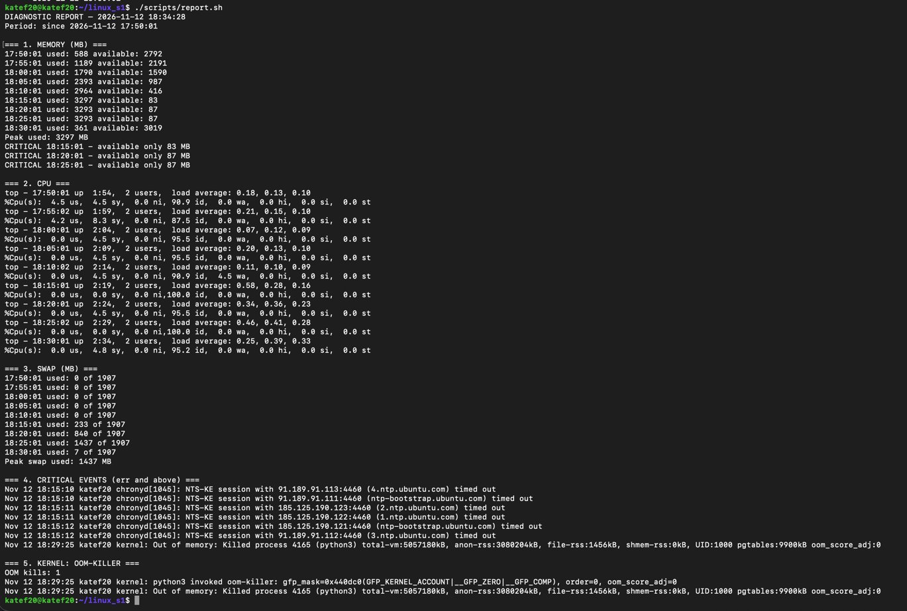

# Среда для тестирования поведения ОС при нехватке памяти

**Итоговое задание** по дисциплине «Операционная система Linux»
**Студентка:** Федосеева Екатерина Михайловна
**Репозиторий:** https://github.com/KateF20/linux_s1

## Содержание

0. [Среда и требование безопасности](#0-среда-и-требование-безопасности)
1. [Процесс с утечкой памяти](#1-процесс-с-утечкой-памяти)
2. [Автоматическое отслеживание раз в 5 минут](#2-автоматическое-отслеживание-раз-в-5-минут)
3. [Мониторинг ресурсов ОС](#3-мониторинг-ресурсов-ос)
4. [Анализ событий ядра и OOM-killer](#4-анализ-событий-ядра-и-oom-killer)
5. [Диагностический отчёт](#5-диагностический-отчёт)
6. [Выводы](#6-выводы)

---

## 0. Среда и требование безопасности

Вся работа с утечкой памяти ведётся **только внутри виртуальной машины**: срабатывание OOM-killer может привести к краху системы.

| Параметр | Значение |
|---|---|
| Гипервизор | UTM (QEMU) на macOS |
| Гостевая ОС | Ubuntu Server 26.04.1 LTS, ядро 7.0.0, aarch64 |
| Оперативная память | 3.3 GiB (3381 МБ) |
| Swap | файл `/swapfile`, 1.9 GiB (1907 МБ) |
| Диск | 9.75 ГБ |

С ВМ я работала с макбука двумя способами:

- **код** писала в PyCharm на macOS (так мне привычнее) и переносила в ВМ через этот репозиторий: `git push` на маке → `git pull` в ВМ и наоборот, когда создать файл или директорию было проще одной командой в терминале;
- **команды** выполняла по `ssh` из терминала мака (`ssh katef20@192.168.64.2`; сеть UTM в режиме Shared Network, ВМ доступна с мака по IP) — так проще работают копирование и вставка и можно держать несколько терминалов сразу + более привычное "общение" с возможностью проскроллить экран даже после команды clear. Часть команд — прямо в консоли ВМ в окне UTM.

Скрипты **запускаются только в ВМ**.

### Добавление swap

Изначально swap в ВМ не было (`Swap: 0B`), и следить за ним было бы нечего. Поэтому я создала файл подкачки:

```bash
sudo fallocate -l 2gb /swapfile
sudo chmod 600 /swapfile       
sudo mkswap /swapfile          
sudo swapon /swapfile          
echo '/swapfile none swap sw 0 0' | sudo tee -a /etc/fstab
```



---

## 1. Процесс с утечкой памяти

Файл: [`scripts/leak.py`](scripts/leak.py)

```python
#!/usr/bin/env python3

import os
import sys
import time

CHUNK_MB = int(sys.argv[1]) if len(sys.argv) > 1 else 50
SLEEP = float(sys.argv[2]) if len(sys.argv) > 2 else 5

leak = []
total = 0

print(f'PID {os.getpid()}: +{CHUNK_MB} MB every {SLEEP} seconds', flush=True)
while True:
    leak.append(b"x" * CHUNK_MB * 1024 * 1024)  # not only VSZ but also RSS
    total += CHUNK_MB
    print(f'{time.strftime('%H:%M:%S')} allocated {total} MB', flush=True)
    time.sleep(SLEEP)
```

Как это работает:

- каждые `SLEEP` секунд выделяется кусок памяти размером `CHUNK_MB` и добавляется в список `leak`. Список никогда не очищается, ссылки на куски живут, поэтому память не освобождается — это и есть утечка;
- `b"x" * N` записывает каждый байт. Из-за ленивого выделения памяти просто зарезервированные страницы не увеличили бы RSS; здесь страницы реально используются, поэтому растёт не только VSZ, но и RSS;
- `flush=True` сразу сбрасывает строку в вывод: когда OOM-killer завершит процесс, последние строки не потеряются в буфере;
- скорость утечки задаётся аргументами, без правки кода.

### Пробный запуск

Быстрая утечка (`50 1` — 50 МБ каждую секунду), без swap. Во втором терминале наблюдаю за процессом:

```bash
python3 scripts/leak.py 50 1  # terminal 1 at VM
ps aux --sort=-%mem | head -5  # terminal 2 at mac via ssh
free -h  # terminal 2
```

RSS процесса `python3 scripts/leak.py` растёт (1.19 → 1.39 → 2.21 ГБ), доступная память падает (586 → 461 → 361 МБ):



На ~3050 МБ ядро завершило процесс — в консоли сообщение OOM-killer:
`Out of memory: Killed process 2215 (python3) total-vm:3193664kB, anon-rss:3168452kB`



### Основной запуск

Для эксперимента утечка медленнее, чтобы мониторинг раз в 5 минут успел записать рост памяти и swap. Запуск в фоне через `nohup`, чтобы процесс не завершился при обрыве `ssh`-сессии:

```bash
nohup python3 scripts/leak.py 20 10 > logs/leak.out 2>&1 &
```

Скорость — 120 МБ в минуту. Доступно около 2960 МБ RAM и 1907 МБ swap, поэтому до срабатывания OOM-killer должно пройти около 40 минут, и мониторинг успеет снять ~8 замеров.

Начало прогона: выделено ~1 ГБ, used 1.4 GiB, swap пока не используется:



Середина прогона: оперативная память почти исчерпана — used 3.2 GiB из 3.3, available всего 86 MiB, буферы и кэш ужались до 74 MiB (ядро отдаёт кэш под нужды процессов). Система начала вытеснять страницы в swap — занято 164 MiB. В логе видны замеры cron строго каждые 5 минут, начиная с 17:50:



Конец прогона. Оперативная память заполнена и больше не меняется (used 3.2 GiB, available ~100 MiB): ядро держит небольшой резерв свободных страниц и, чтобы выдать процессу новую память, вытесняет в swap его старые страницы. Поэтому swap быстро растёт — 1.5 → 1.8 GiB, свободно осталось 61 MiB. Это же видно по процессу: RSS (то, что лежит в RAM) стоит на ~2.9 ГБ, а VSZ (вся память процесса) вырос до 4.9 ГБ — разница и есть то, что ушло в swap.

Когда закончился и swap, в 18:29 ядро вызвало OOM-killer и завершило процесс — сообщение ядра выводится прямо в консоль:

```
Out of memory: Killed process 4165 (python3) total-vm:5057180kB, anon-rss:3080204kB, file-rss:1456kB, shmem-rss:0kB, UID:1000 pgtables:9900kB oom_score_adj:0
```

bash сообщает, что его фоновая задача завершена сигналом (`[1]+ Killed nohup python3 scripts/leak.py 20 10 ...`), а `ps aux | grep leak.py` находит только сам `grep`:



---

## 2. Автоматическое отслеживание раз в 5 минут

Мониторинг запускает планировщик **cron**. Строка в crontab пользователя (`crontab -e`, копия — в [`cron.txt`](cron.txt)):

```
*/5 * * * * /home/katef20/linux_s1/scripts/monitor.sh
```

- `*/5` в поле минут — каждые 5 минут, остальные поля `*` — любой час/день/месяц/день недели;
- путь к скрипту абсолютный: cron запускает задачи в урезанном окружении;
- задание стоит в crontab обычного пользователя, а не root. Пользователь `katef20` состоит в группе `adm`, поэтому может читать системный журнал без `sudo` — повышенные права мониторингу не нужны.

Проверка: cron пишет в журнал о каждом запуске, а в логе мониторинга появляются блоки с интервалом 5 минут:

```bash
crontab -l
journalctl -u cron --since "10 min ago"
grep "=====" logs/monitor.log
```



(Запуск в 17:20 с пустой командой `CMD ()` — промежуточная версия crontab во время редактирования; после `RELOAD` в 17:21 задание запускается с правильным путём.)

---

## 3. Мониторинг ресурсов ОС

Файл: [`scripts/monitor.sh`](scripts/monitor.sh)

```bash
#!/bin/bash

LOG=/home/katef20/linux_s1/logs/monitor.log

{
  echo "===== $(date '+%F %T') ====="

  echo "--- Память и swap ---"
  free -m

  echo "--- CPU ---"
  top -b -n 1 | head -3

  echo "--- Top 3 processes sorted by memory ---"
  ps aux --sort=-%mem | head -4

  echo "--- Critical errors last 5 min ---"
  journalctl -p err --since "5 minutes ago" --no-pager -q

  echo "--- Core: OOM-killer last 5 min ---"
  journalctl -k --since "5 minutes ago" --no-pager -q | grep -i "out of memory"

  echo
} >> "$LOG"
```

При каждом запуске скрипт дописывает в `logs/monitor.log` блок с отметкой времени:

| Ресурс | Команда | Что видно |
|---|---|---|
| Память | `free -m`, строка `Mem:` | всего / занято / доступно (available), МБ |
| Swap | `free -m`, строка `Swap:` | всего / занято, МБ |
| CPU | `top -b -n 1 \| head -3` | load average, `%Cpu(s)`: us, sy, id, wa (`-b` — пакетный режим для скриптов) |
| Кто потребляет память | `ps aux --sort=-%mem \| head -4` | 3 самых «прожорливых» процесса: VSZ, RSS |
| Критические события | `journalctl -p err --since "5 minutes ago"` | сообщения уровня err и выше за последний интервал |
| Ядро / OOM | `journalctl -k ... \| grep -i "out of memory"` | срабатывания OOM-killer за последний интервал |

Окно `--since "5 minutes ago"` совпадает с интервалом запуска, поэтому одно и то же событие не попадает в лог дважды. `-q` убирает служебную строку `-- No entries --`.

Перед тем как собрать скрипт, я проверила каждую команду вручную. Здесь же видно, что `journalctl -k` без `sudo` находит OOM-событие пробного запуска, а `groups` подтверждает членство в `adm`:



Первый запуск скрипта:



Во время основного прогона cron запускал скрипт каждые 5 минут с 17:50 до 18:30 — 9 блоков в [`logs/monitor.log`](logs/monitor.log). Числа из этих блоков собраны в таблицы диагностического отчёта (раздел 5).

---

## 4. Анализ событий ядра и OOM-killer

Когда памяти (вместе со swap) не хватает, ядро вызывает OOM-killer, и тот принудительно завершает процесс. Исключения внутри Python при этом нет — процесс просто исчезает, а причина остаётся только в журнале ядра. Ядро пишет две ключевые строки:

- `... invoked oom-killer: ...` — какой процесс запросил память, когда её не осталось;
- `Out of memory: Killed process PID (имя) total-vm:..., anon-rss:...` — какой процесс убит и сколько памяти он занимал.

Анализ выполняет раздел 5 скрипта `report.sh`: он берёт события ядра (`journalctl -k`) за период наблюдений, считает количество срабатываний и выводит обе строки.

### Основной прогон: разбор строки `Killed process`

| Поле | Значение | Смысл |
|---|---|---|
| Время | 12.11.2026, 18:29:25 | момент срабатывания OOM-killer |
| PID, имя | **4165 (python3)** | тот же процесс `leak.py`, что был виден в `ps` |
| `total-vm` | 5 057 180 kB ≈ **4.8 ГБ** | вся виртуальная память процесса (RAM + swap) |
| `anon-rss` | 3 080 204 kB ≈ **2.9 ГБ** | анонимная память (куча с утечкой), находившаяся в RAM |
| `total-vm − anon-rss` | ≈ **1.9 ГБ** | ≈ весь объём swap — к моменту «убийства» он был заполнен |
| `UID:1000` | пользователь `katef20` | процесс обычного пользователя, не системный |
| `oom_score_adj:0` | приоритет не менялся | ядро выбрало жертву по собственной оценке — процесс с наибольшим потреблением памяти |

### Кто вызвал OOM-killer

Раздел 5 отчёта нашёл за период наблюдений ровно одно срабатывание (`OOM kills: 1`) и обе строки ядра:

```
=== 5. KERNEL: OOM-KILLER ===
OOM kills: 1
Nov 12 18:29:25 katef20 kernel: python3 invoked oom-killer: gfp_mask=0x440dc0(GFP_KERNEL_ACCOUNT|__GFP_ZERO|__GFP_COMP), order=0, oom_score_adj=0
Nov 12 18:29:25 katef20 kernel: Out of memory: Killed process 4165 (python3) total-vm:5057180kB, anon-rss:3080204kB, file-rss:1456kB, shmem-rss:0kB, UID:1000 pgtables:9900kB oom_score_adj:0
```

- `python3 invoked oom-killer` — OOM-killer вызвал **сам процесс с утечкой**: при очередном запросе памяти ядро не нашло свободной страницы ни в RAM, ни в swap;
- `order=0` — запрашивалась всего одна страница памяти: системе не хватило даже минимального объёма;
- обе строки в одну секунду (18:29:25): вызов и «убийство» происходят сразу, жертвой стал тот же процесс, что и вызвал нехватку, — он занимал больше всех памяти.

---

## 5. Диагностический отчёт

Файл: [`scripts/report.sh`](scripts/report.sh). Результат: [`logs/report.txt`](logs/report.txt).

```bash
#!/bin/bash

LOG=/home/katef20/linux_s1/logs/monitor.log
REPORT=/home/katef20/linux_s1/logs/report.txt

SINCE=$(grep -m1 "=====" "$LOG" | awk '{print $2, $3}')

{
  echo "DIAGNOSTIC REPORT — $(date '+%F %T')"
  echo "Period: since $SINCE"
  echo

  echo "=== 1. MEMORY (MB) ==="
  awk '/^=====/ {t=$3} /^Mem:/ {print t, "used:", $3, "available:", $7}' "$LOG"
  awk '/^Mem:/ {if ($3 > max) max = $3} END {print "Peak used:", max, "MB"}' "$LOG"
  awk '/^=====/ {t=$3} /^Mem:/ && $7 < 300 {print "CRITICAL", t, "- available only", $7, "MB"}' "$LOG"
  echo

  echo "=== 2. CPU ==="
  grep -E "^top -|^%Cpu" "$LOG"
  echo

  echo "=== 3. SWAP (MB) ==="
  awk '/^=====/ {t=$3} /^Swap:/ {print t, "used:", $3, "of", $2}' "$LOG"
  awk '/^Swap:/ {if ($3 > max) max = $3} END {print "Peak swap used:", max, "MB"}' "$LOG"
  echo

  echo "=== 4. CRITICAL EVENTS (err and above) ==="
  journalctl -p err --since "$SINCE" --no-pager -q
  echo

  echo "=== 5. KERNEL: OOM-KILLER ==="
  echo "OOM kills: $(journalctl -k --since "$SINCE" --no-pager -q | grep -c "Killed process")"
  journalctl -k --since "$SINCE" --no-pager -q | grep -E "invoked oom-killer|Killed process"
} > "$REPORT"

cat "$REPORT"
```

| Раздел отчёта | Откуда данные | Что считается |
|---|---|---|
| 1. Память | строки `Mem:` из `monitor.log` | used и available на каждый замер, пик used, замеры с available < 300 МБ помечены `CRITICAL` |
| 2. CPU | строки `top -` и `%Cpu` из `monitor.log` | load average и распределение времени CPU на каждый замер |
| 3. Swap | строки `Swap:` из `monitor.log` | занятый swap на каждый замер, пик |
| 4. Критические события | `journalctl -p err` за период наблюдений | все ошибки уровня err и выше |
| 5. Ядро / OOM-killer | `journalctl -k` за период наблюдений | число срабатываний, строки `invoked oom-killer` и `Killed process` |

- Начало периода берётся из первого блока лога: `grep -m1` находит первую строку `=====`, `awk` достаёт из неё дату и время.
- `awk` идёт по логу построчно: на строке-заголовке запоминает время `t`, на строках `Mem:`/`Swap:` печатает его вместе с нужными полями. Так получается таблица «время → значение».
- Отчёт перезаписывается (`>`), а не дописывается.

### Результат: отчёт по основному прогону

Отчёт сгенерирован в 18:34 — после срабатывания OOM-killer и ещё одного запуска мониторинга. Полный текст — [`logs/report.txt`](logs/report.txt).



**1. Память (МБ)**

| Время | used | available |
|---|---|---|
| 17:50 | 588 | 2792 |
| 17:55 | 1189 | 2191 |
| 18:00 | 1790 | 1590 |
| 18:05 | 2393 | 987 |
| 18:10 | 2964 | 416 |
| 18:15 | 3297 | **83** ⚠️ |
| 18:20 | 3293 | **87** ⚠️ |
| 18:25 | 3293 | **87** ⚠️ |
| 18:30 | 361 | 3019 |

Пик used — 3297 МБ. Три замера помечены `CRITICAL` (available < 300 МБ): 18:15, 18:20, 18:25.

**2. CPU.** Load average за весь прогон — от 0.07 до 0.58 (максимум в 18:15, когда кончилась RAM и началась подкачка), CPU простаивает 87.5–100 % времени (`id`). В 18:10 впервые появилось ожидание ввода-вывода `wa` 4.5 % — система начала обращаться к диску.

**3. Swap (МБ)**

| Время | used из 1907 |
|---|---|
| 17:50 – 18:10 | 0 |
| 18:15 | 233 |
| 18:20 | 840 |
| 18:25 | 1437 |
| 18:30 | 7 |

Пик по замерам — 1437 МБ. Реальный пик был между замерами, перед самым OOM: по `free -h` в ~18:28 swap был занят на 1.8 GiB, свободно 61 MiB (см. скриншот в разделе 1).

**4. Критические события (err и выше)**

- 18:15:10–18:15:12 — шесть ошибок `chronyd: NTS-KE session ... timed out`: служба синхронизации времени не дождалась ответа от NTP-серверов Ubuntu. По времени это совпадает с моментом, когда RAM кончилась (available 83 МБ) и система начала активно использовать swap; возможно, служба не уложилась в таймаут из-за общей нагрузки, но это может быть и сетевая проблема — по этим данным однозначно не сказать;
- 18:29:25 — `kernel: Out of memory: Killed process 4165 (python3)` — сообщение ядра об OOM имеет уровень err, поэтому попало и сюда.

**5. Ядро / OOM-killer** — одно срабатывание в 18:29:25, разбор — в разделе 4.

---

1. **Память** росла линейно, примерно на 600 МБ за каждые 5 минут — как и задано утечкой (20 МБ каждые 10 секунд). Через ~25 минут, к 18:15, оперативная память кончилась: available упал до 83 МБ и дальше не опускался — ядро держит небольшой резерв свободных страниц и отдаёт под нужды процесса дисковый кэш (buff/cache ужался с ~550 до ~75 МБ).
2. **Swap** не использовался, пока хватало RAM, и включился, только когда она закончилась (18:15). Дальше он заполнялся с той же скоростью, с какой шла утечка: ядро вытесняло на диск старые страницы процесса, освобождая RAM под новые. Поэтому RSS процесса остановился на ~2.9 ГБ, а VSZ продолжал расти до 4.8 ГБ.
3. **CPU** узким местом не был: load average не превысил 0.58, процессор большую часть времени простаивал. Утечка памяти почти не нагружает процессор; её признаки — падение available, рост swap и появление ожидания ввода-вывода (`wa`).
4. **OOM-killer** сработал в 18:29:25, когда закончился и swap (≈ 41 минута после старта): ядро завершило процесс-«виновник» — `python3`, PID 4165, занимавший ~4.8 ГБ виртуальной памяти. Других процессов OOM-killer не тронул (`OOM kills: 1`), система продолжила работать: через минуту used вернулся к 361 МБ, swap освободился.
5. **Критические события** в журнале за время эксперимента — таймауты `chronyd` в момент исчерпания RAM и сообщение ядра об OOM.
6. **Мониторинг** отработал по расписанию все 9 раз (17:50–18:30) без пропусков, в том числе в момент нехватки памяти, а отчёт по его логу и журналам ядра показывает всю картину: рост памяти → включение swap → исчерпание swap → OOM-killer.

---

*Использование ИИ:* при выполнении задания я пользовалась Claude (Anthropic) как помощником: он подсказывал команды и предлагал код скриптов, а также подготовил черновик описаний (README и этот файл) по моим результатам. Виртуальную машину, swap, git и cron я настраивала сама, каждую команду проверяла вручную в ВМ, эксперимент проводила и скриншоты делала сама; текст описаний проверила.
